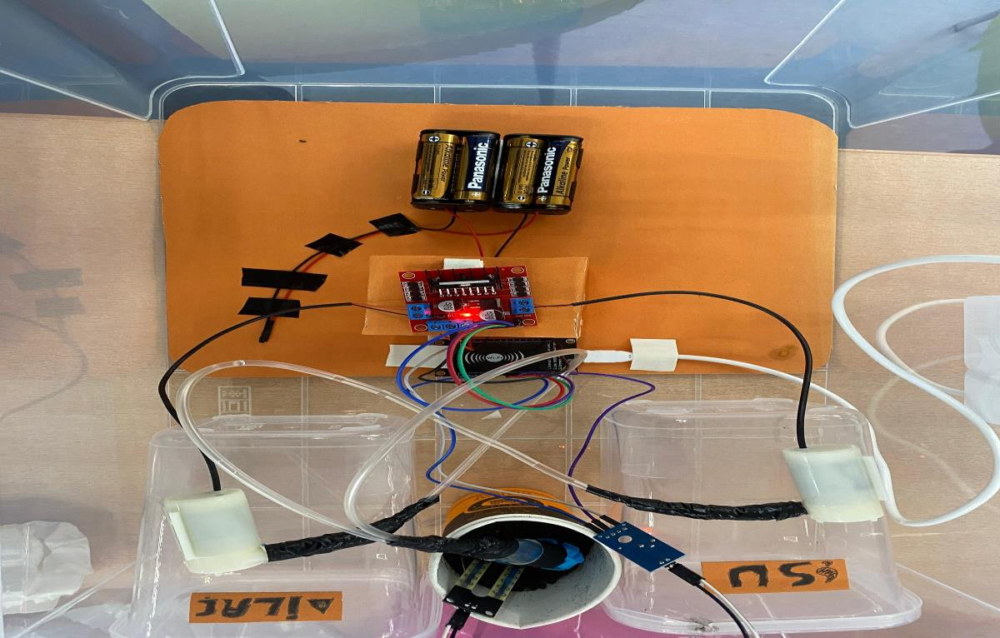
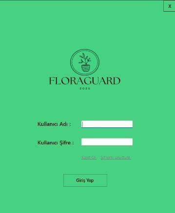
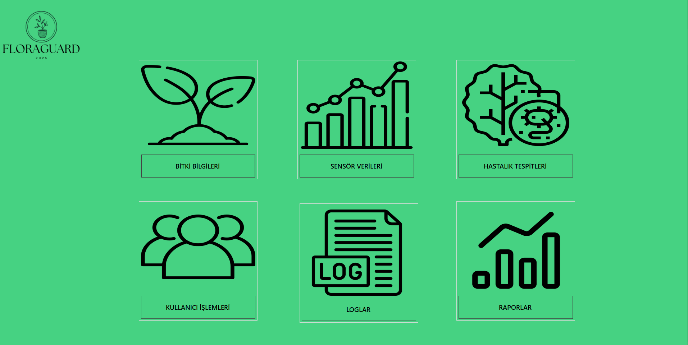
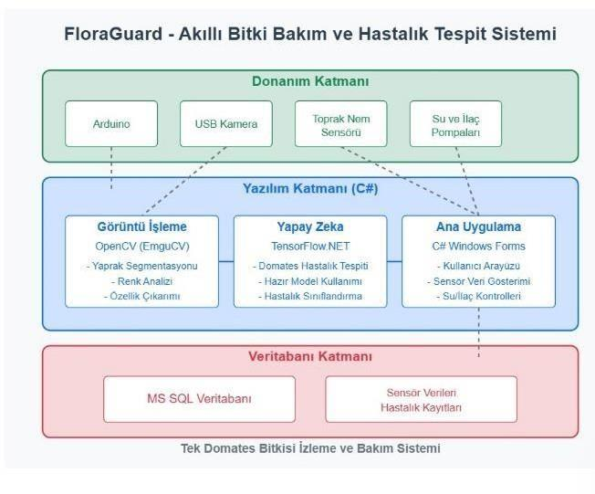
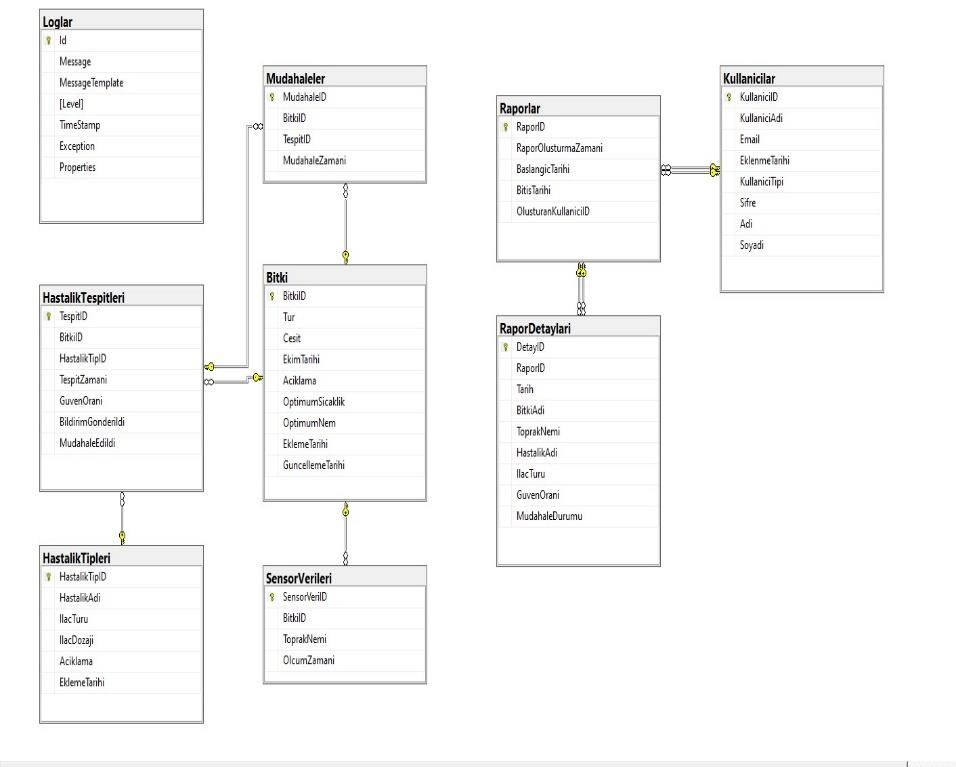
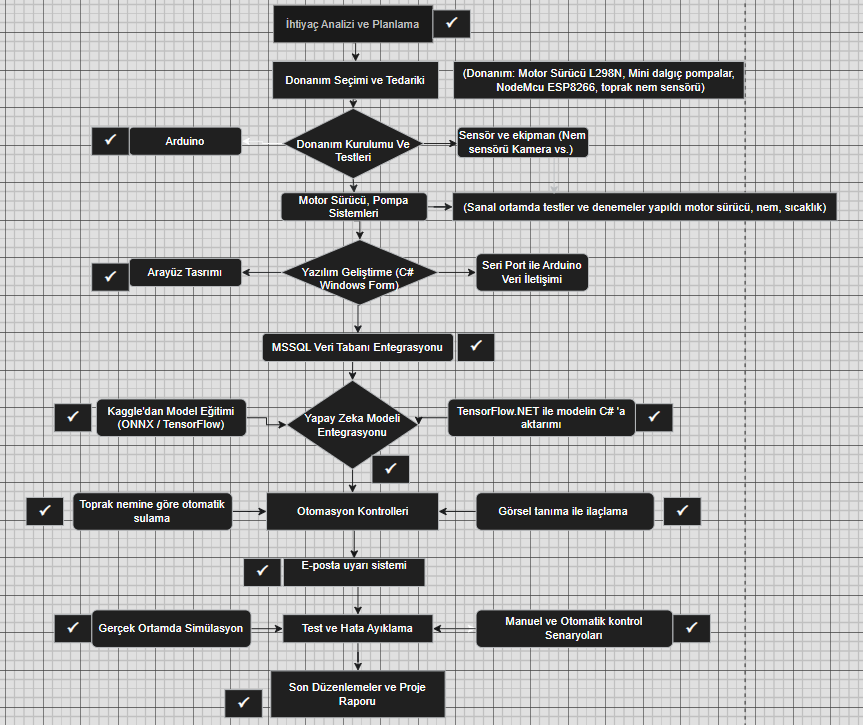

# FloraGuard 🌱

**Smart plant care and disease detection system** built with C# Windows Forms, an ONNX deep learning model and an Arduino/ESP8266 irrigation unit.

FloraGuard detects tomato leaf diseases from a camera feed or an image, monitors soil moisture in real time, waters the plant automatically and notifies the user by e-mail when a disease is found. Image processing, sensor data, hardware automation and a desktop UI are combined in a single application.

<p align="center">
  
</p>

## The Problem

- Plant diseases are often noticed too late.
- Manual monitoring is time-consuming.
- Over- or under-watering and wrong treatment damage crops.

## The Solution

A camera and an AI model detect the disease, a soil moisture sensor tracks the plant's condition, and an Arduino-controlled pump system waters the plant or sprays treatment, either automatically or on the user's command.

## Features

- **Disease detection:** classifies tomato leaves (e.g. early blight, late blight, healthy) with an ONNX model, from a live camera or a selected image
- **Soil moisture monitoring:** live sensor data shown as charts with date filters
- **Automatic irrigation:** the pump starts when soil moisture drops below a threshold
- **Manual intervention:** send water or treatment from the app via serial port
- **E-mail alerts:** administrators are notified when a disease is detected (SMTP)
- **AI assistant:** ask questions about the detected disease through the OpenAI API
- **Plant management:** add, update and delete plants with optimum moisture and temperature values
- **User management:** registration, login, password reset and roles (user / admin)
- **Reports and history:** detection and intervention history, filterable by date
- **Logging:** application events, hardware errors and model predictions recorded with Serilog

## Screenshots

| Login | Main menu |
|---|---|
|  |  |

## System Architecture

<p align="center">
  
</p>

The system has three layers:

1. **Hardware layer:** ESP8266 NodeMCU, soil moisture sensor, USB camera, water/treatment pumps
2. **Software layer (C#):** image processing (OpenCV/AForge), AI inference (ONNX Runtime), Windows Forms application
3. **Database layer:** MS SQL Server for sensor data, detections, interventions and users

<details>
<summary>Database diagram and project workflow</summary>





</details>

## Tech Stack

| Area | Technologies |
|---|---|
| Application | C#, .NET 8, Windows Forms |
| AI / Vision | ONNX Runtime, TensorFlow.NET, OpenCV (Emgu.CV, OpenCvSharp), AForge.NET |
| Model training | Python, Kaggle dataset, exported to ONNX |
| Database | Microsoft SQL Server (SQL Express) |
| Hardware | ESP8266 NodeMCU, soil moisture sensor, relay/motor driver, mini water pumps |
| Other | Serilog, Newtonsoft.Json, System.Net.Mail, OpenAI API |

## Project Structure

```
FloraGuard/
├── FloraGuardProje/        # Windows Forms application source code
├── docs/                   # User guide and images
├── script.sql              # Database creation script
├── FloraGuardProje.sln     # Visual Studio solution
└── LICENSE
```

## Getting Started

### Requirements

- Windows 10/11
- Visual Studio 2022 with the **.NET desktop development** workload (.NET 8)
- SQL Server Express (and SQL Server Management Studio)
- Arduino IDE (only if you use the hardware part)

### 1. Clone the repository

```bash
git clone https://github.com/Zeyntrn/FloraGuard.git
```

### 2. Create the database

Open `script.sql` in SQL Server Management Studio and run it. Then update the server name in `FloraGuardProje/SqlBaglantisi.cs`:

```csharp
Data Source=YOUR_SERVER_NAME\SQLEXPRESS;Initial Catalog=FloraGuardDB;Integrated Security=True;
```

### 3. Add the AI model

The trained model (`tomato_leaf_model.onnx`, about 92 MB) is not stored in the repository. Download it from the [Releases](../../releases) page and place it in the project folder next to the application files.

### 4. Set the secrets

API keys and passwords are **not** stored in the code. Define them as environment variables (then restart Visual Studio):

```
setx OPENAI_API_KEY "your_openai_api_key"
setx FLORAGUARD_SMTP_PASSWORD "your_gmail_app_password"
```

The e-mail sender address is configured in `HastalikTespitRepository.cs`.

### 5. Build and run

Open `FloraGuardProje.sln` in Visual Studio and press **F5**.

### 6. Hardware setup (optional)

Wiring, Arduino code and test steps are described in [docs/FloraGuard_user_manual.pdf](docs/FloraGuard_user_manual.pdf). In the app, open **Arduino Connection**, choose the COM port (e.g. COM3) and click **Connect**.

## Usage

1. Register or log in.
2. Add your plant under **My Plants**.
3. Connect the Arduino (optional).
4. Open **Disease Detection**, start the camera or choose an image and click **Analyze**.
5. If a disease is found, review the suggestion and send an intervention.
6. Track soil moisture, history and reports from the related screens.

## What I Learned

- Integrating a trained deep learning model (Python → ONNX) into a C# desktop application
- Serial communication between a PC and a microcontroller
- Designing a relational database and connecting it to a Windows Forms application
- Keeping secrets out of source code with environment variables

## Team

Developed as a team project in the Computer Programming program at Bursa Uludağ University.

All team members worked together on every part of the project, including the Windows Forms interface, database design, AI model integration, Arduino hardware setup and testing.

- **Zeynep Turan**

## License

This project is licensed under the [MIT License](LICENSE).
